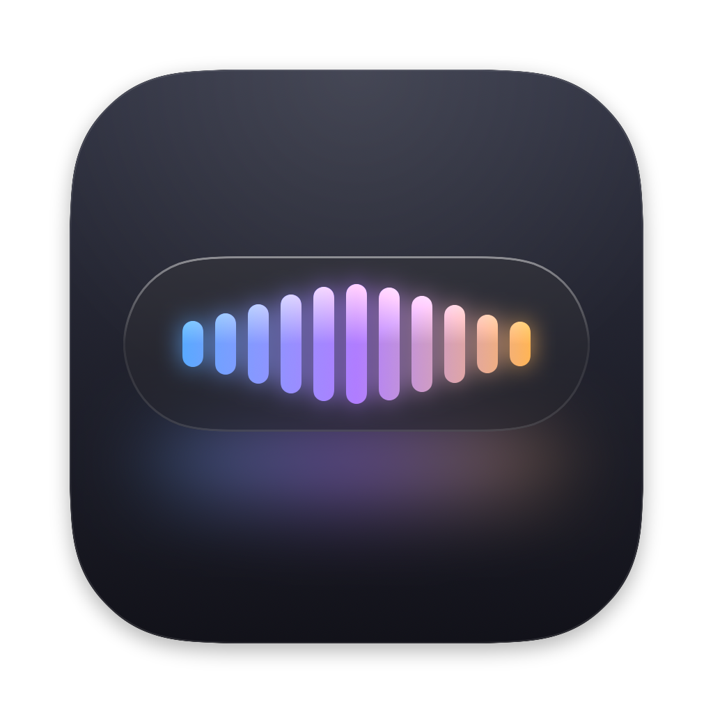
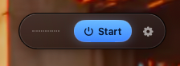
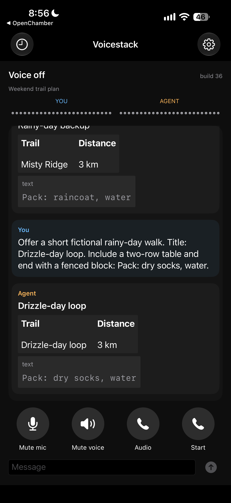
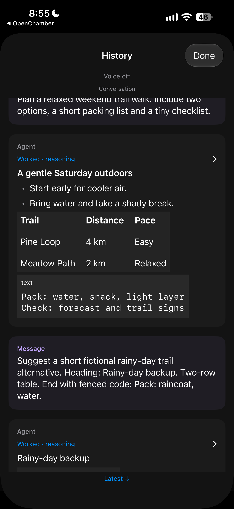
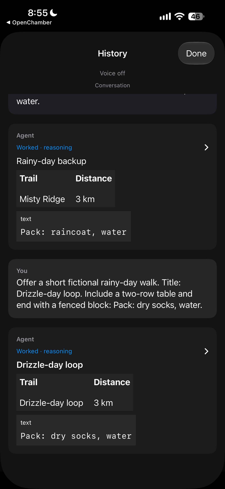
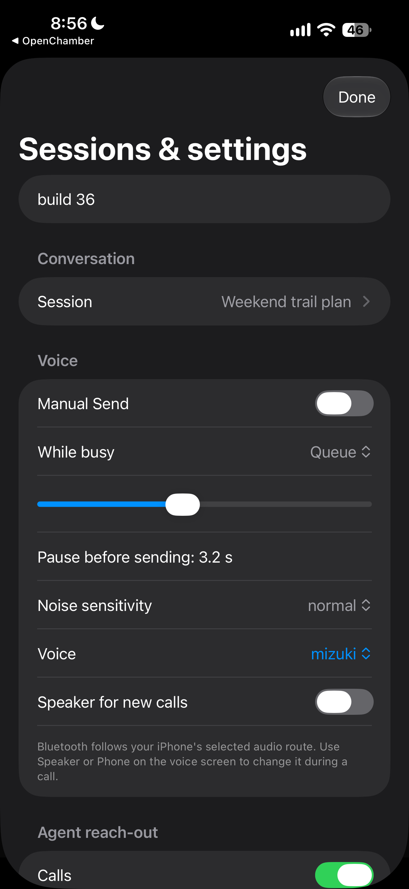

# Voicestack



Two independent voice clients for OpenChamber: a floating macOS pill and a native iPhone companion. This is a **local, sanitized source review snapshot**, not a supported binary distribution. No source histories or live configuration are included.

Voicestack is an **independent project used alongside Workstack**, not a Workstack
kit or submodule. It retains its own name and original selected logos, outside
Workstack's comic-mascot styling. Using it with the harness is optional; this
classification does not change the client/service requirements below.

**Canvas source build r5 completed locally and was independently corroborated.**
The existing macOS arm64 Node 26.10.0/esbuild 0.25.12 toolchain built the exact
4,008 inputs plus reviewed metadata, all six resources, and published the success
manifest after observed child close. The earlier resolver-metadata failure and
incomplete attempts remain historical provenance, not current build status.
Independent review checked hashes/metafile/transforms/source freshness and passed
16 pure lifecycle checks; it did not rebuild or run browser/native code. This is
a source-only recipe/pins release form, **not package/release clearance or a
distributable app**. See the [renderer status and limits](ios/bridge/renderer/README.md).

## What is here

- `macos/`: prospective private source based on original Mac `4c33124f8bf318313e460210ecf55018f648e692`. The paired selection includes declared safety, synthetic, frozen R3 and sparse ROBUSTNESS adaptations only at their declared destinations; it is not a raw-commit-exact copy. A floating pill with live captions when the recognition server supports partials, configurable input/output devices, automatic or manual Send, discard, sender labels, and `[voice]` attribution on spoken submissions. Its speech clients use external servers; it does not start them.
- `ios/`: prospective private source based on original phone `7b81fb6a48c34b124f1b6d7563c98424f40290b4`, with the paired selection's declared adaptations, not raw-commit-exact source. Native CallKit calling, turn-taking, sender labels, history and Canvas panels, quiet-hours policy, notifications and urgent calls, and a separate revocable OpenChamber client identity through the bridge. The owner report of build 31 installed and accepted on real calls is historical only, not acceptance of this proposed pair or native/release proof; this adapted source pair has **not** been compiled or device-tested.
- The accepted Graphite / icon 1 artwork is retained byte-for-byte in both app resource locations. These are icons, not screenshots.

The apps do not import a speculative shared core. Their similarly named Swift files have intentionally remained independent.

**Not claimed:** build-32 acknowledgement-aware cut-in, locked/pocket calling, away-from-desk acceptance, App Store readiness, notarization, a public IPA, or a completed release build.

## Dependencies and compatibility

You supply and operate these separately:

1. **OpenChamber desktop**, with an active agent session. OpenCode alone is not a substitute for its desktop API. No OpenChamber/OpenCode binary or server is bundled. Mac discovery can use `FV_OPENCHAMBER_URL`; iPhone uses the project-owned bridge and explicit OpenChamber client enrollment. Exact upstream-version compatibility must be revalidated; this snapshot does not certify a version range.
2. **Speech services**, compatible with the custom ASR WebSocket and TTS subset below. Typical local endpoints are `ws://127.0.0.1:8446/v1/transcribe` and `http://127.0.0.1:8444/v1/audio/speech`. Models, reference voices, provider keys and recordings are not supplied. The apps connect to separately operated services; they do not start or stop them.
3. For iPhone: **Node.js with modern built-in fetch/WebSocket support** (Node 22+ is a starting prerequisite, not a tested version matrix), Python 3.10+, an operator-configured private HTTPS/tailnet route, Apple development signing and push capabilities, and the bridge. Use Node 22 with a release providing global WebSocket, or newer compatible Node.
4. For iPhone Canvas: the [pinned local source-build recipe](ios/bridge/renderer/README.md), owned MIT Canvas subset and exact external dependency lock. Generate renderer JS/CSS and all four libraries into ignored `ios/output` before iOS packaging or bridge use. Missing/stale resources fail closed. The independent Mac pill does not use these resources. No generated third-party bundles are distributed; [binary rights gates](DEPENDENCIES.md) remain parked.

Swift packages specify tools version 6.0, Swift language mode 5. Mac targets macOS 14+; the iPhone project targets iOS 17+. Native `.icon` compilation needs an Xcode/SDK with Icon Composer support (Xcode 26-class tooling); the Mac recipe can fall back to PNG → ICNS with Command Line Tools. These declared targets are not build verification on older SDKs or hardware.

### Speech contracts and model choices

Models are separately operated deployment choices expected to change, especially
TTS, not bundled or arbitrary drop-ins. The current local gateway is Breeze-specific:
`--upstream` changes the Breeze address, not the backend protocol; request `model`
is ignored. Another backend needs a compatible adapter/replacement gateway.
The existing Parakeet/Voxtral ASR adapters likewise limit model choices.

- **TTS:** POST `/v1/audio/speech` implements an OpenAI Speech **subset**: WAV or
  streamed headerless mono 24 kHz s16le PCM. It does not promise full format,
  SSE, speed-control or voice-management API parity. Voices are operator-registered
  stems or the operator's `default`, not OpenAI's local built-in catalog.
- **ASR:** `/v1/transcribe` is a custom one-utterance WebSocket, not OpenAI
  Transcriptions or Realtime. Send binary mono 16 kHz s16le PCM, then
  `input_audio.end`; keep the socket open for results until normal server close.
  Append committed `transcript` text; replace display text for `transcript.partial`
  snapshots, rather than appending them or duplicating a final after committed deltas.

If using the separate speech setup's endpoint helper, it edits only `asrUrl`,
`ttsUrl` and optional `ttsStream`. It cannot set model/voice/keys/headers or a
partials query, reload clients or perform inference. Review each service's auth,
formats and data handling separately; cloud calls, credential use, upload/retention
permission and automatic fallback are not implied by configuration support.

## Mac: configure, build, use

Review the code and resource gates first. On a separate development setup, from this repo:

```sh
cd macos
sh scripts/build-app.sh
```

This builds `macos/build/Voicestack.app` and signs it ad hoc; it does not install or launch it. Optional output must be a fresh direct child of `macos/build`; existing output is refused. The independent Mac pill has no local Canvas WebView and does not require bridge renderer resources to build. The bundle identifier remains `local.floating-voice`; do not replace a live install during review. No notarization or distribution signing is provided.

Use `macos/config/settings.example.json` as a starting point for your own settings. The default app settings location is `~/.config/floating-voice/settings.json`, overridable with `FV_SETTINGS`. Existing agent-voice settings are read only and may supply speech defaults; this app's values override them. Do not put API keys in committed examples.

Set `voice` to an operator-registered stem or `default` for the local gateway.
The example's `alloy` works locally only if that exact stem was registered;
`ttsModel` does not select the local backend. Mac requests support `ttsUrl`,
`ttsModel`, `voice`, `ttsStream` (PCM when true, WAV otherwise) and `ttsApiKey`
as Bearer auth. A compatible cloud TTS request is possible, not verified drop-in
UX: derived health probes tolerate 404, but other failures can block use, and
missing `/v1/voices` can limit voice selection. ASR has its own URL/Bearer key
and still requires the custom WebSocket contract above.

Set `target` to your own session ID, or use `chief` with your own chief-pointer JSON (`session` field). `FV_TARGET` and `FV_CHIEF_FILE` are overrides. A Chief-kit install is optional if you select an explicit session. `FV_OPENCHAMBER_URL` selects a configured desktop API endpoint; no live session identifiers are shipped.

After you independently start OpenChamber and your speech servers, open your development app, select devices and target, then Start voice. Automatic mode sends after configured pauses; manual mode holds words for Send (including the configurable global shortcut). Discard clears held words. Captions distinguish your speech, the assistant and external senders. Stop voice when finished. The app pauses rather than fighting agent-voice for microphone ownership. This staging task did not open the app or microphone.

## iPhone: development setup and use

This is **source-only development setup**, not a ready IPA installation path. See [ios/SETUP.md](ios/SETUP.md) for bridge, enrollment and signing configuration. Start by filling `ios/config/build.env.example` outside version control. An unconfigured build has an empty bridge URL and empty `PairingBootstrap`; it cannot connect to an existing deployment accidentally.

Unlike the Mac request path, shipped iOS replaces speech URLs and keys with
bridge/device routes and credentials. The bridge uses loopback speech ports and
does not forward an arbitrary provider key. Cloud substitution needs an
operator-managed compatible proxy/adapter or code changes, not simply a cloud URL.

The staged iPhone namespace is `org.example.voicestack`, with an empty team. Choose an identifier and signing team you own for an independent development app; APNs topic must match. This changes only these staged sources. The installed app, its identifier, Keychain identity, credentials and owner checkout are untouched. This copy is not an update/migration package for the accepted app.

First follow the renderer recipe with a fresh ignored `ios/output` direct child;
keep the same explicit `FV_CANVAS_RESOURCES` for resource verification, bridge
and iOS generation/build. Do not automatically reuse a developer's r5 scratch
output. The project generator is local-only Python:

```sh
python3 ios/native/build.py generate
```

First create `ios/private` yourself as an owner-owned mode-0700 directory (no symlink ancestors). Generation exclusively publishes a new mode-0600 `ios/private/NativeInfo.plist`, with empty bootstrap by default, without contacting Apple or building. Existing output is refused, not replaced. The build recipe's `unsigned`/`archive` actions require explicit `FV_ALLOW_BUILD=1`; an archive also requires your signing team and pre-provisioned resources. Automatic provisioning downloads are disabled. These build actions were **not run** for staging, and their success is unknown. No install, launch, simulator, OTA or proof-delivery recipe is provided here.

**Fresh enrollment configuration:** the pinned app reads its one-use bootstrap from signed configuration, not a runtime pairing-entry screen. Explicit `FV_BUILD_MODE=ENROLL` accepts one operator-selected private JSON file or JSON environment input; see [ios/SETUP.md](ios/SETUP.md). Never pass a secret on the command line. Enrollment-signed apps contain a redeemable one-use secret: protect the app and all build artifacts, then regenerate empty UPDATE configuration after enrollment. This source/configuration path is fixture-tested only, not signing or pairing acceptance.

Once separately provisioned and paired, choose the intended session in the app and start/answer a call. History and sender labels accompany voice; Canvas uses the preflighted local bridge renderer output. Configure notification/call permissions and quiet hours deliberately. Urgent calls are policy-limited, not Critical Alerts or a Focus bypass. Revoke the dedicated desktop client in OpenChamber to cut off paired bridge access; authenticated rejection fails closed rather than borrowing someone else's credentials. The inherited absent-binding legacy mode is not proof of authentication: enroll the dedicated client explicitly. Do not assume locked/background call behavior is accepted.

## Validation and release boundaries

Secure first-enrollment and own-client preflight have selected local-fixture
acceptance, including the corrected nonzero origin port gate (1–65535). Canvas
r5 has the bounded source-build corroboration above, not native acceptance.
Further copied-resource review completed 13 named checks, then stopped with
overall Node 1 when a later raw-path refusal assertion returned normally; its
exact case/count was not journaled. Complete consumer/unsafe-path execution
coverage remains unresolved; no product defect is proved by that outcome.
Other staging checks cover syntax, plist/project/resource references, synthetic
protocol fixtures and isolated Python configuration generation. No Swift
compilation, full-suite acceptance, app/browser execution, live pairing/provider
call, signing, device/simulator action or service activation was performed.
Some retained integration tests intentionally open sockets or exercise audio;
do **not** run whole suites as an offline check without reviewing containment.

Original owned Voicestack source/documentation is now MIT under [LICENSE](LICENSE), as approved by the principal. [RIGHTS.md](RIGHTS.md) defines the scope and supersedes only stale owned-code pending-license statements in preserved dependency/nested docs and metadata. Outside dependencies, libraries, compilers, vendor binaries, models, reference audio/media, artwork and generated resources receive no new grant. Preserve [THIRD_PARTY.md](THIRD_PARTY.md), the Canvas MIT license and all existing notices and dependency/source-availability obligations. Native/signing/device/browser/clean-install acceptance, dependency resolution on other hosts, a standard secret scanner, release privacy review, principal logo approval, further genuine privacy-safe captures, model/reference rights and third-party binary rights remain unestablished. Mermaid/Fastdom/ELK binary redistribution stays parked; no license waiver or all-platform/hermetic build proof is implied. Generated third-party resources, compiler and node_modules must stay out of Git and source archives. No audio, models, private state, source history or credentials are included. Only the selected cleared captures below are included. The earlier local snapshot's no-commit/no-remote/no-push status is historical, not a claim about any future unified candidate commit. Previously reported build/validation results remain historical and do not validate this proposed pair; no push or release is authorized by this proposal.

## Selected independent Voicestack captures



Owner-provided compact desktop pill with waveform, Start and settings controls. App/build labels are not visible: build identity, idle state, ASR and call behavior are unknown from this image. The approved sRGB derivative intentionally color-converted the original RGB; no further conversion is made here.



Full real iPhone build 36 main frame with voice off, a fictional trail-plan table/code and round controls.



Full real iPhone build 36 History detail: fictional trail heading/bullets, three-column table and checklist code; reasoning rows are collapsed.



Full real iPhone build 36 History latest with two fictional trail replies and a You ask; Worked · reasoning rows are collapsed, not expanded-reasoning proof.



Full real iPhone build 36 frame showing Sessions and settings controls for session, send/queue, pause, sensitivity, voice and speaker. Settings coverage is partial, not exhaustive.

These four full phone frames show real build 36 UI with fictional trail-plan content, no keyboard or visible AssistiveTouch. They are not native test results, call/ASR acceptance, source-code-pin acceptance or proof of expanded reasoning. These images do not validate the proposed adapted `4c`/`7b81` source pair. Mac `153c34c`, iOS `ce4d180` / stable build 31 and private baseline `459788dc5fc9a82d96b0b1d9562c95d2fa6eba32` remain unchanged historical bindings, not this proposed pair's source identity. Voicestack retains its independent original identity; these selected images do not clear other imaging, functional, native, install, version, history, privacy, rights or publication gates.

# Correction lane policy/build notes

Install links now default to **deny**. See `ios/shared/INSTALL_POLICY.md` for the
explicit matching bridge/native operator policy. A `.ts.net` hostname alone is
not an ownership assertion.

Optional Mac builds reserve a **new** direct `macos/build/<name>.app` output;
existing outputs (including generated ones) are always refused. Choose a fresh
name; do not use an installed/live app as output. No overwrite or replacement
recipe is provided. Actual native Canvas and enrollment acceptance remain pending.
The documented deployment requires the offline own-client preflight, and CLI `serve`
enforces it before state/socket creation. This checks local shape/identity, not live
credential validity. Library/test legacy fallback remains available, never deployment
install-readiness. These corrections do not make the snapshot install-ready.
